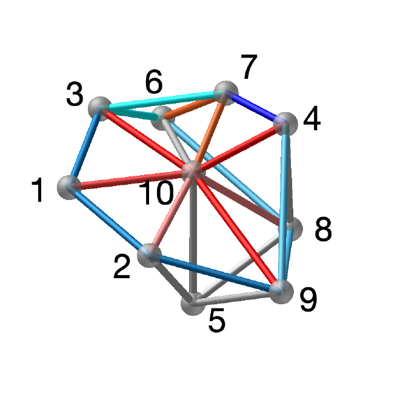

# Animations

## Figure 3(d–f) · Ten-sphere framework

| Figure 3(d) · Unperturbed | Figure 3(e) · Initial condition | Figure 3(f) · Final state |
| --- | --- | --- |
|  |  |  |

- **Figure 3(d).** The original framework is case 6 from the ten-sphere packing dataset.
- **Figure 3(e).** Perturbing the vertex positions gives the initial condition for the optimization. This framework is not prestress stable.
- **Figure 3(f).** Minimizing the length of the bar between vertices 1 and 3 while keeping all other bar lengths fixed gives a prestress-stable framework with one independent self-stress.

[Watch or download the MATLAB animation (MP4)](figure-3e-to-3f-matlab.mp4)

The video begins at Figure 3(e) and shows the first 200 optimization steps toward Figure 3(f). The chart tracks the squared length of the free bar between vertices 1 and 3.

## Figure 2(a–d) · Planar frameworks

- **Figure 2(a–b), hexagon.** The optimization maximizes the length of the diagonal between vertices 1 and 4 while keeping the other bar lengths fixed. [Watch the MATLAB animation (MP4)](figure-2a-to-2b-matlab.mp4)
- **Figure 2(c–d), connected triangles.** The optimization minimizes the length of the bar between vertices 5 and 6 while keeping the other bar lengths fixed. [Watch the MATLAB animation (MP4)](figure-2c-to-2d-matlab.mp4)

Each video shows the framework alongside a chart of the free bar’s squared length during optimization.
