# Animations

## Figure 2(a–b) · Hexagon

| Regular hexagon · Unperturbed | Figure 2(a) · Perturbed initial condition | Figure 2(b) · Final state |
| --- | --- | --- |
| 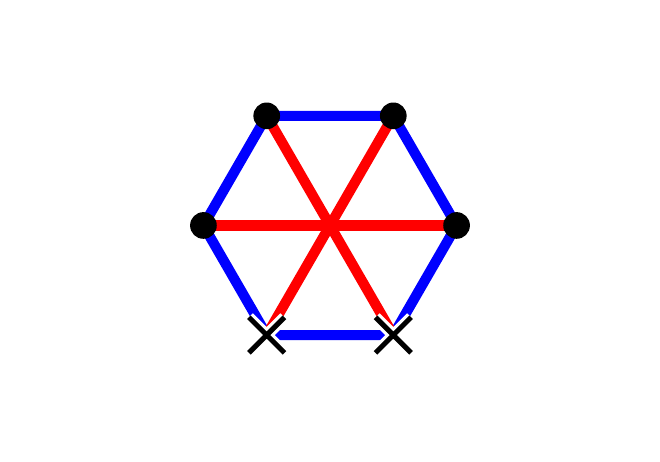 |  |  |

In the self-stress shown on the regular hexagon, all three diagonals are in tension (red) and the six perimeter bars are in compression (blue). The animation starts from the perturbed hexagon in Figure 2(a). Maximizing the length of the diagonal between vertices 1 and 4 while keeping the other bar lengths fixed gives the prestress-stable framework in Figure 2(b). [Watch the MATLAB animation (MP4)](figure-2a-to-2b-matlab.mp4)

**Maximization · Squared length of edge 1–4**

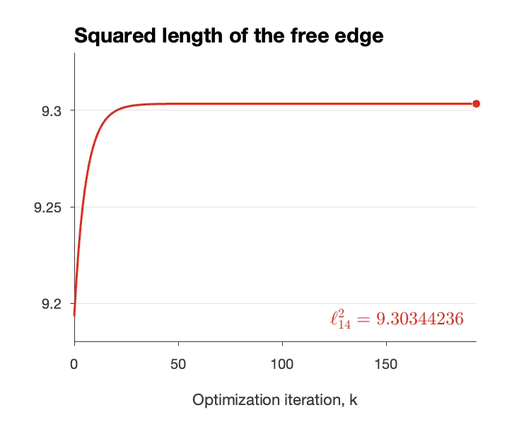

## Figure 2(c–d) · Connected triangles

| Figure 2(c) · Initial condition | Figure 2(d) · Final state |
| --- | --- |
| 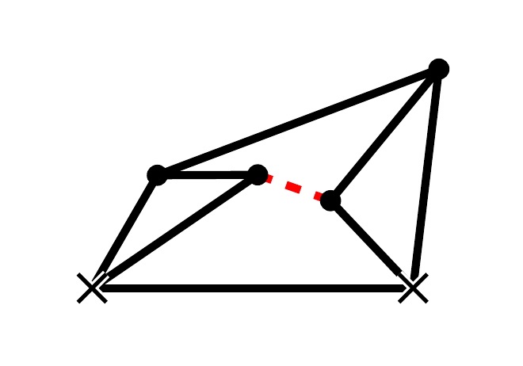 | 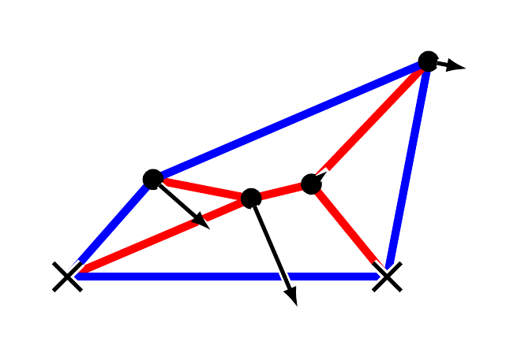 |

Minimizing the length of the bar between vertices 5 and 6 in Figure 2(c) while keeping the other bar lengths fixed gives the prestress-stable framework in Figure 2(d). [Watch the MATLAB animation (MP4)](figure-2c-to-2d-matlab.mp4)

**Minimization · Squared length of edge 5–6**

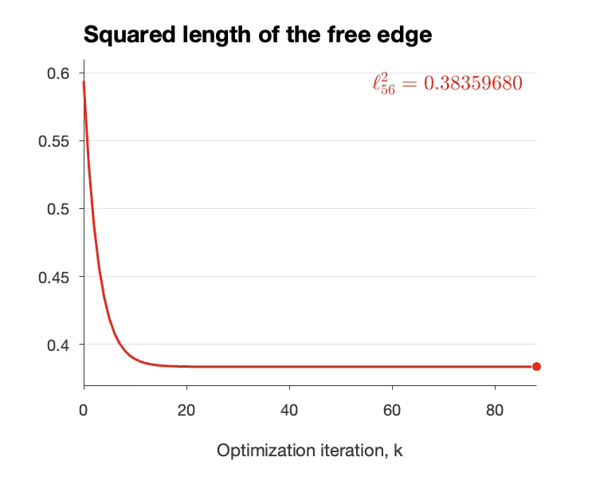

In the Figure 2 final panels, red bars are in tension and blue bars are in compression. Crosses mark pinned vertices, and arrows show the pinned infinitesimal flex.

## Figure 3(a–c) · Nine-sphere framework

| Figure 3(a) · Unperturbed | Figure 3(b) · Perturbed initial condition | Figure 3(c) · Final state |
| --- | --- | --- |
| 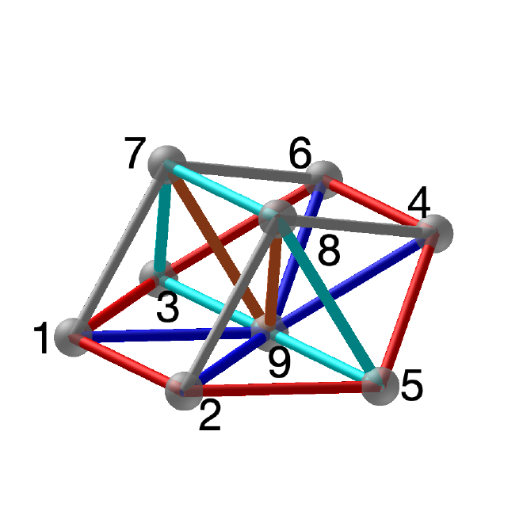 | 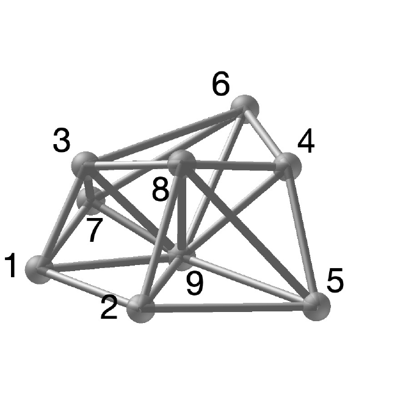 | 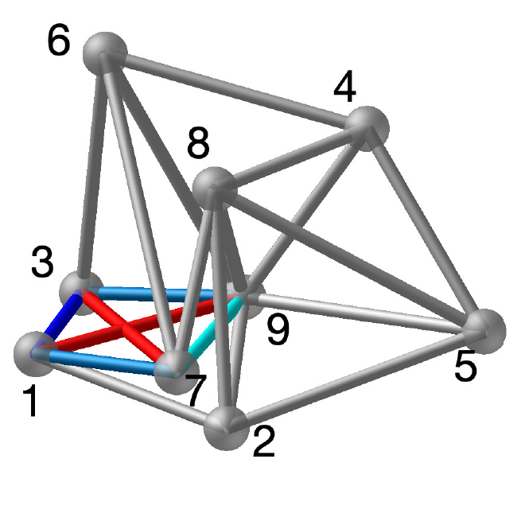 |

The original framework is case 1 from the nine-sphere packing dataset. The video starts at the perturbed framework in Figure 3(b) and shows the first 200 steps toward Figure 3(c). Maximizing the length of the bar between vertices 3 and 7 while keeping the other bar lengths fixed gives a prestress-stable framework with one independent self-stress. [Watch the MATLAB animation (MP4)](figure-3b-to-3c-matlab.mp4)

**Maximization · Squared length of edge 3–7**

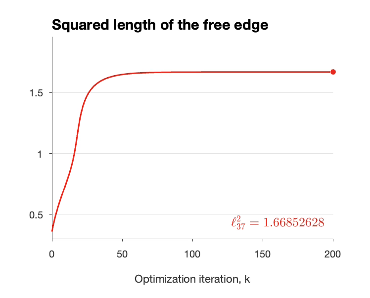

## Figure 3(d–f) · Ten-sphere framework

| Figure 3(d) · Unperturbed | Figure 3(e) · Initial condition | Figure 3(f) · Final state |
| --- | --- | --- |
|  |  |  |

- **Figure 3(d).** The original framework is case 6 from the ten-sphere packing dataset.
- **Figure 3(e).** Perturbing the vertex positions gives the initial condition for the optimization. This framework is not prestress stable.
- **Figure 3(f).** Minimizing the length of the bar between vertices 1 and 3 while keeping all other bar lengths fixed gives a prestress-stable framework with one independent self-stress.

[Watch or download the MATLAB animation (MP4)](figure-3e-to-3f-matlab.mp4)

The video begins at Figure 3(e) and shows the first 200 optimization steps toward Figure 3(f).

**Minimization · Squared length of edge 1–3**

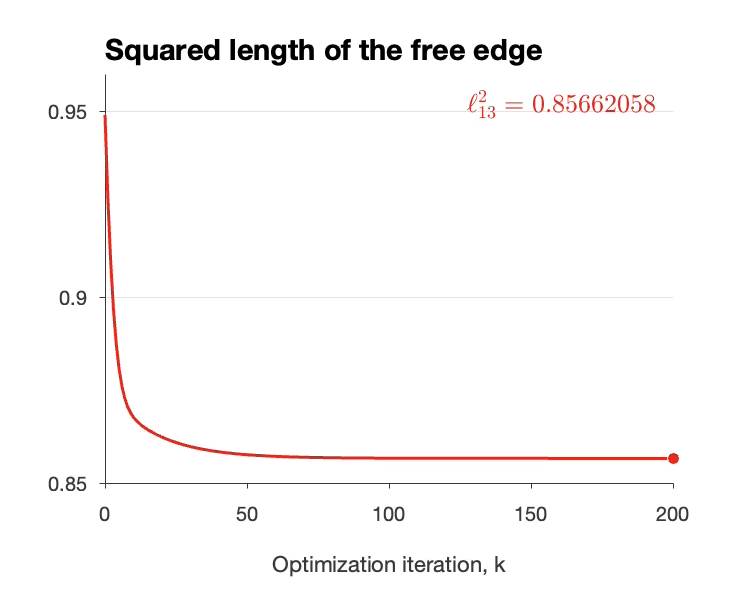

## Figure 4(a–b) · Midpoint constraints

| Unperturbed · Concentric squares | Figure 4(a) · Perturbed initial condition | Figure 4(b) · Final state |
| --- | --- | --- |
| 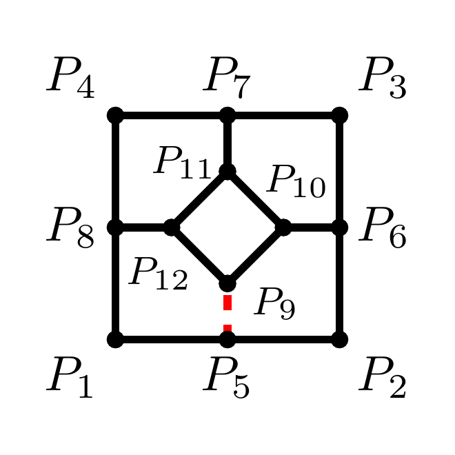 | 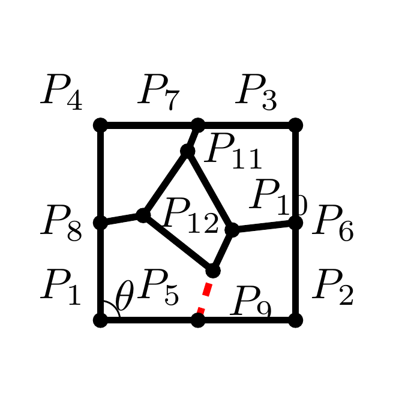 | 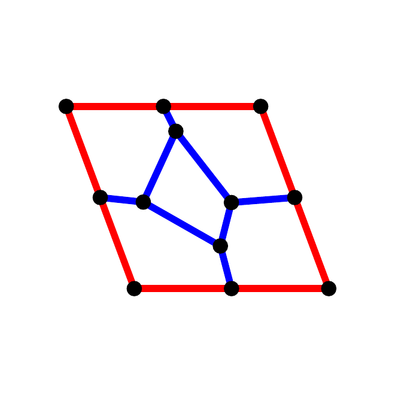 |

In the unperturbed framework, the inner and outer squares share a center, and the inner square is rotated 45° relative to the outer square. Each connecting bar meets the corresponding outer side at its midpoint and at a right angle. The animation starts from the perturbed inner quadrilateral in Figure 4(a) and shortens the bar between vertices 5 and 9 while preserving the other bar lengths and the four midpoint constraints. The final framework is prestress stable. [Watch the MATLAB animation (MP4)](figure-4a-to-4b-matlab.mp4)

**Minimization · Squared length of edge 5–9**

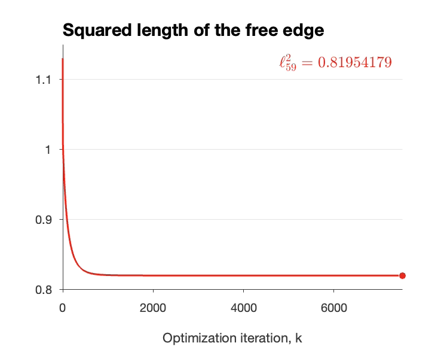

## Figure 5(a, d) · Stress design for stacked squares

| Figure 5(a) · Initial condition | Figure 5(d) · Final state |
| --- | --- |
| 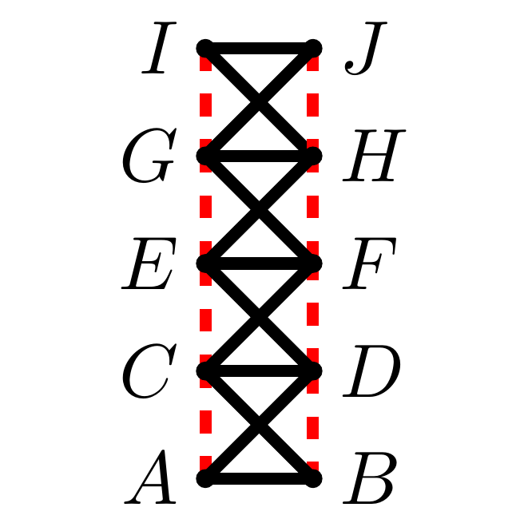 | 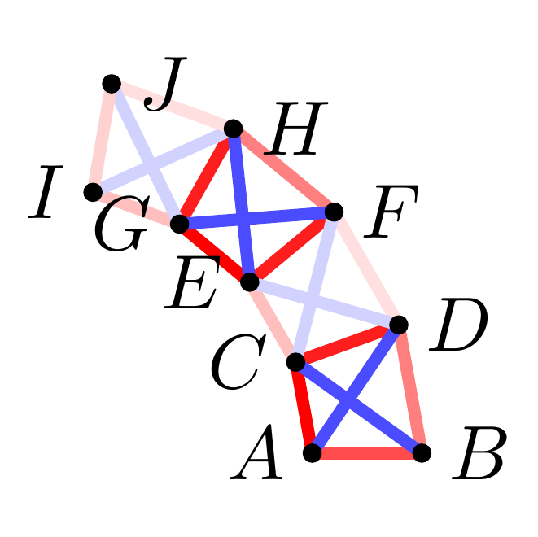 |

The final framework admits a self-stress with the target ratio **8:4:2:1:8:4:2:1** on edges AC, BD, CE, DF, EG, FH, GI, and HJ, in that order. [Watch the MATLAB animation (MP4)](figure-5a-to-5d-matlab.mp4)

**Minimization · Weighted sum of the eight target edges’ squared lengths**

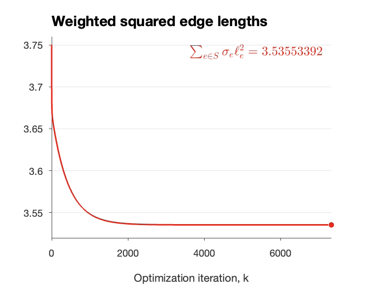

## Figure 5(b, e) · Stress design for a ten-sphere framework

| Figure 5(b) · Initial condition | Figure 5(e) · Final state |
| --- | --- |
| 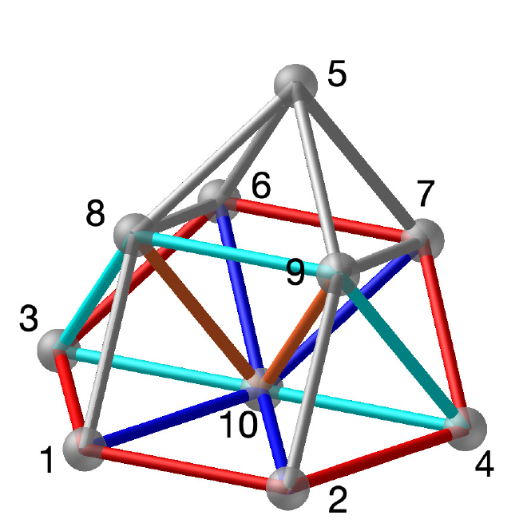 | 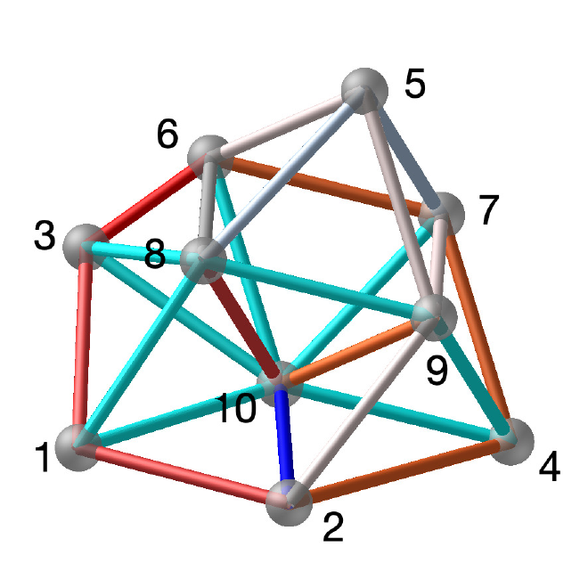 |

The optimization changes the self-stress ratio on edges 2–4 and 3–6 from **1:1** to **1:2**. [Watch the MATLAB animation (MP4)](figure-5b-to-5e-matlab.mp4)

**Minimization · Weighted sum of the two target edges’ squared lengths**

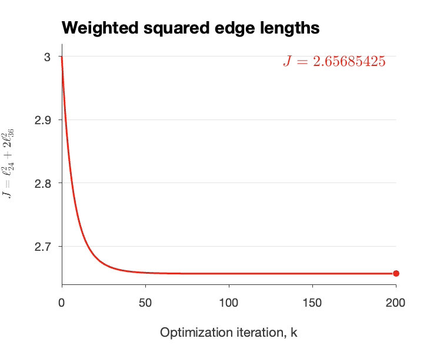

## Figure 5(c, f) · Stress design for an eleven-sphere framework

| Figure 5(c) · Initial condition | Figure 5(f) · Final state |
| --- | --- |
| 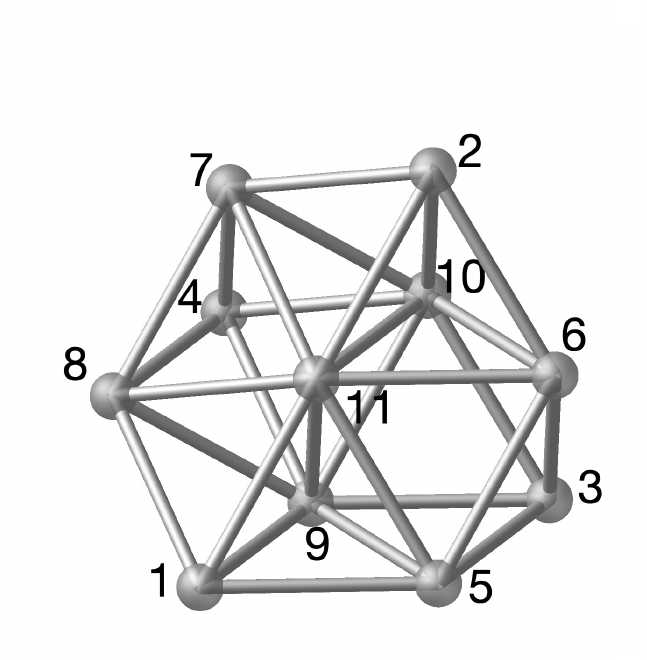 | 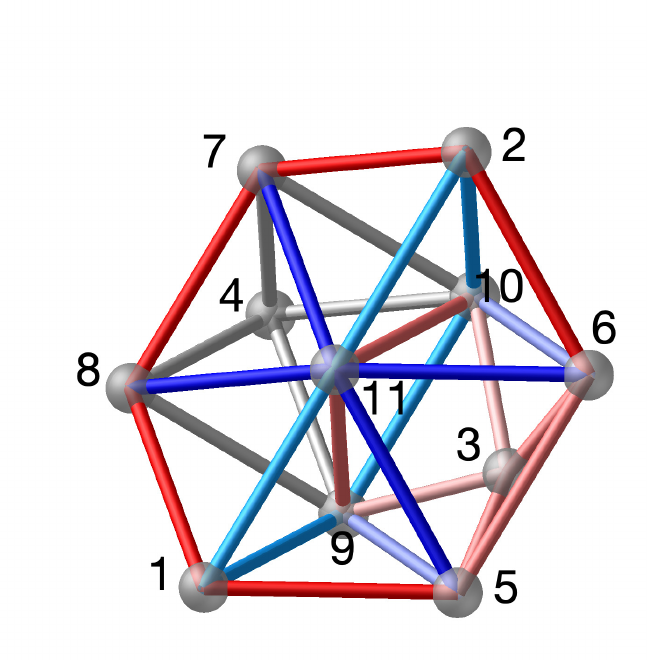 |

The final framework admits a self-stress with the target ratio **2:3:2** on edges 3–5, 2–6, and 3–6, in that order. [Watch the MATLAB animation (MP4)](figure-5c-to-5f-matlab.mp4)

**Minimization · Weighted sum of the three target edges’ squared lengths**

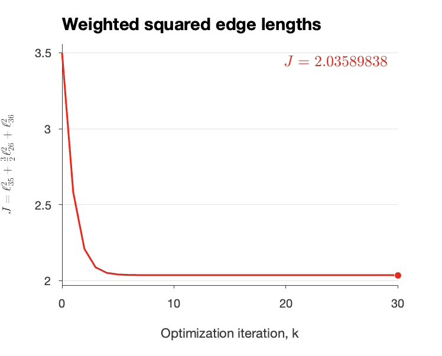
