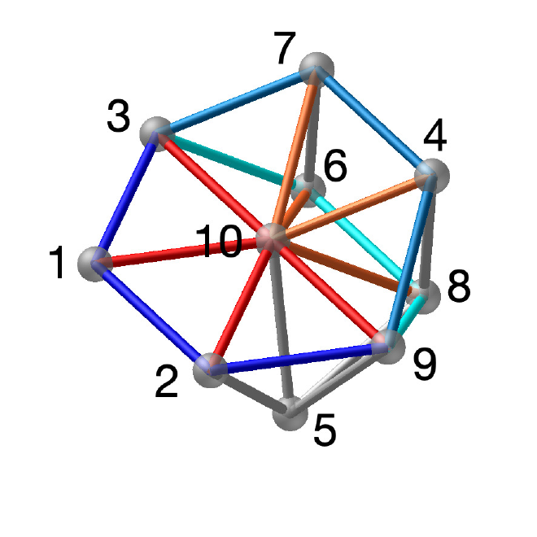

# Animations

## Figure 3(d–f) · Ten-sphere framework

| Figure 3(d) · Unperturbed | Figure 3(e) · Initial condition | Figure 3(f) · Final state |
| --- | --- | --- |
|  |  |  |
| The original framework is case 6 from the ten-sphere packing dataset. | Perturbing the vertex positions gives the initial condition for the optimization. This framework is not prestress stable. | Minimizing the length of the bar between vertices 1 and 3 while keeping all other bar lengths fixed gives a prestress-stable framework with one independent self-stress. |

[Watch or download the MATLAB animation (MP4)](figure-3e-to-3f-matlab.mp4)

The video begins at Figure 3(e) and shows the first 200 optimization steps toward Figure 3(f). The chart tracks the squared length of the free bar between vertices 1 and 3.
