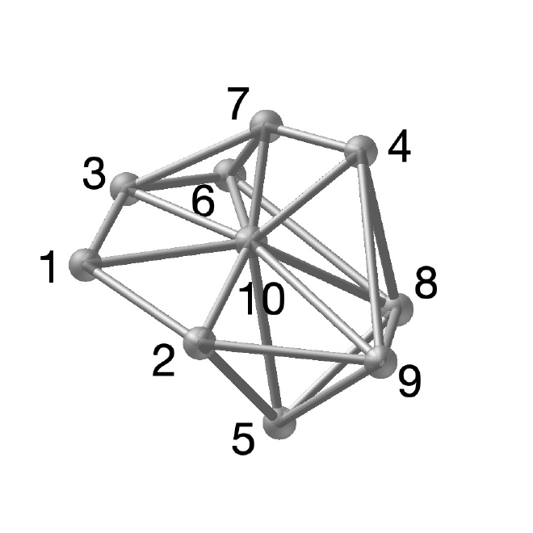
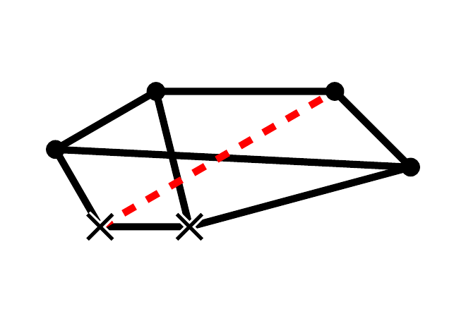
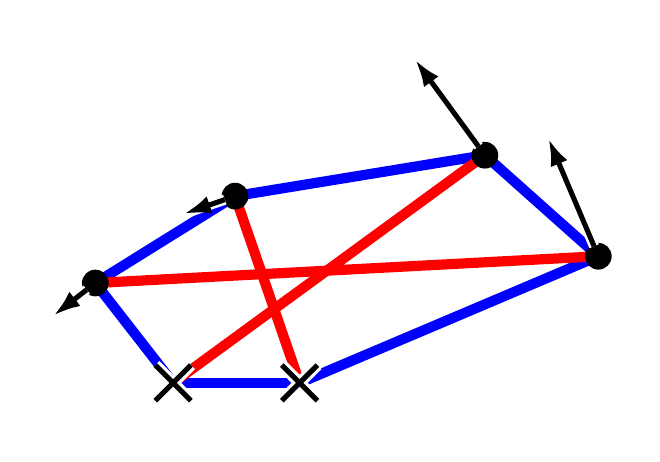

# Animations

## Figure 3(d–f) · Ten-sphere framework

| Figure 3(d) · Unperturbed | Figure 3(e) · Initial condition | Figure 3(f) · Final state |
| --- | --- | --- |
|  |  |  |

- **Figure 3(d).** The original framework is case 6 from the ten-sphere packing dataset.
- **Figure 3(e).** Perturbing the vertex positions gives the initial condition for the optimization. This framework is not prestress stable.
- **Figure 3(f).** Minimizing the length of the bar between vertices 1 and 3 while keeping all other bar lengths fixed gives a prestress-stable framework with one independent self-stress.

[Watch or download the MATLAB animation (MP4)](figure-3e-to-3f-matlab.mp4)

The video begins at Figure 3(e) and shows the first 200 optimization steps toward Figure 3(f). The chart tracks the squared length of the free bar between vertices 1 and 3.

## Figure 2(a–b) · Hexagon

| Regular hexagon · Unperturbed | Figure 2(a) · Perturbed initial condition | Figure 2(b) · Final state |
| --- | --- | --- |
|  |  |  |

The regular hexagon has the same bar connections as Figure 2(a). The animation starts from the perturbed hexagon in Figure 2(a). Maximizing the length of the diagonal between vertices 1 and 4 while keeping the other bar lengths fixed gives the prestress-stable framework in Figure 2(b). [Watch the MATLAB animation (MP4)](figure-2a-to-2b-matlab.mp4)

## Figure 2(c–d) · Connected triangles

| Figure 2(c) · Initial condition | Figure 2(d) · Final state |
| --- | --- |
|  |  |

Minimizing the length of the bar between vertices 5 and 6 in Figure 2(c) while keeping the other bar lengths fixed gives the prestress-stable framework in Figure 2(d). [Watch the MATLAB animation (MP4)](figure-2c-to-2d-matlab.mp4)

Both Figure 2 animations track the squared length of the free bar. In the final panels above, red bars are in tension and blue bars are in compression. Crosses mark pinned vertices, and arrows show the pinned infinitesimal flex.
